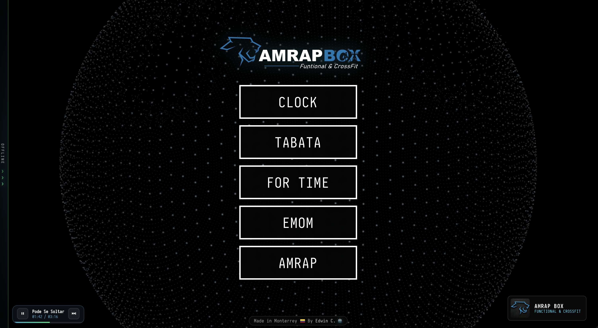
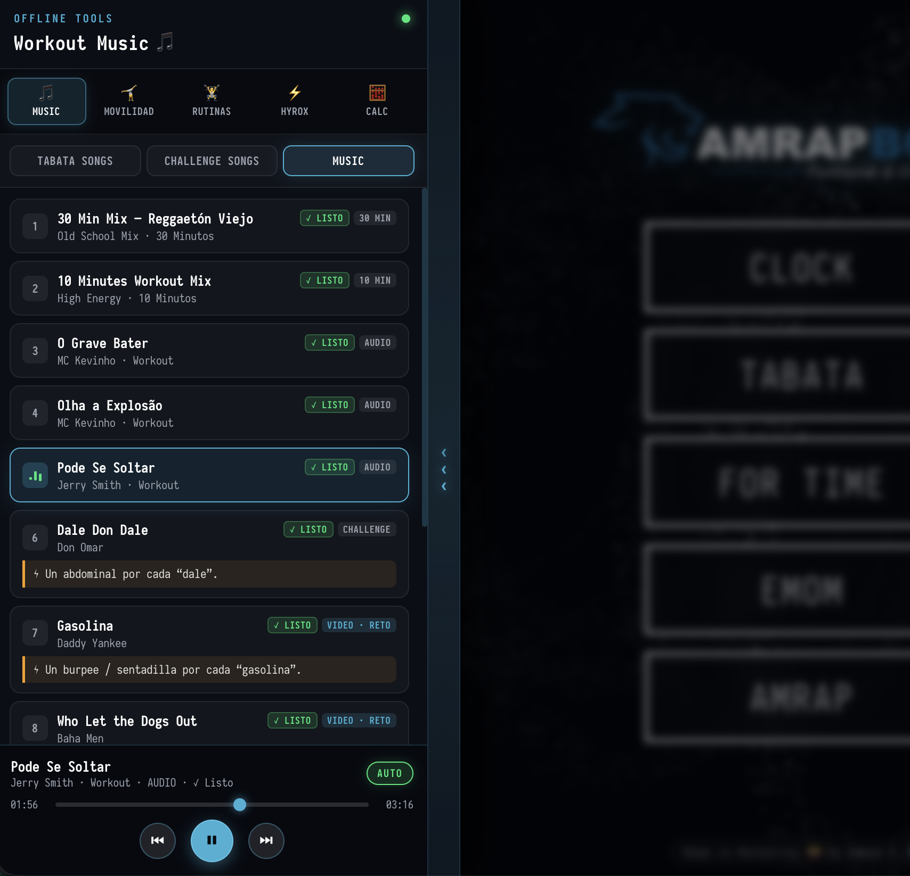

<!--
  _____    _          _          ____      _     _ _ _           
 | ____|__| |_      _(_)_ __    / ___|   _| |__ (_) | | ___  ___ 
 |  _| / _` \ \ /\ / / | '_ \  | |  | | | | '_ \| | | |/ _ \/ __|
 | |__| (_| |\ V  V /| | | | | | |__| |_| | |_) | | | | (_) \__ \
 |_____\__,_| \_/\_/ |_|_| |_|  \____\__,_|_.__/|_|_|_|\___/|___/
-->

<div align="center">

# 🏋️‍♂️ AMRAP BOX — WOD Timer & Offline Tools

**Sistema integral de cronometraje para CrossFit & Functional Training con suite Offline de Música, Retos, Movilidad CF-L2, 60 WODs de Box, Serie HYROX 100 y Calculadoras de Atleta.**

-00e5ff.svg)


</div>

---

## 📸 Vista Previa del Sistema

### 1. Pantalla Principal Renderizada (`AMRAP BOX`)
Vista general con la esfera 3D interactiva de partículas, selector central de modos (`CLOCK`, `TABATA`, `FOR TIME`, `EMOM`, `AMRAP`), pestaña lateral sutil `OFFLINE` y el **Mini-Player flotante** en la esquina inferior izquierda reproduciendo en segundo plano:

<div align="center">
  
</div>

### 2. Menú Lateral Desplegable (`Offline Tools`)
Detalle del panel lateral izquierdo desplegado con acceso rápido a **🎵 Music**, **🤸 Movilidad**, **🏋️ Rutinas**, **⚡ HYROX** y **🧮 Calc**, estado de almacenamiento local `✓ LISTO`, tarjetas de retos (*Challenge Songs*) y reproductor completo con modo secuencial `AUTO`:

<div align="center">
  
</div>

---

## ⚙️ ¿Cómo Funciona el Proyecto?

El proyecto está diseñado bajo una arquitectura **Local-First (sin servidores externos ni cuentas)** ideal para pantallas de Box, televisores o MacBooks en pista. Se compone de dos grandes bloques que funcionan de forma simultánea:

```text
+-----------------------------------------------------------------------------------+
|                           AMRAP BOX · WOD TIMER ENGINE                            |
+-----------------------------------------+-----------------------------------------+
| 1. MOTOR PRINCIPAL DE TIEMPO (Derecha)  | 2. SUITE OFFLINE TOOLS (Panel Izquierdo)|
| --------------------------------------- | --------------------------------------- |
| • CLOCK + Cronómetro Minimalista Oculto | • 🎵 Workout Music (Tabata/Retos/Mixes) |
| • TABATA (Trabajo / Descanso / Rondas)  | • 🤸 Movilidad (Caminatas/Parejas/CF-L2)|
| • FOR TIME (Cronómetro + Time Cap)      | • 🏋️ Rutinas (30 Partner + 30 Indiv.)   |
| • EMOM (Intervalos + Rondas automáticas)| • ⚡ HYROX 100 (Individual & Doubles)   |
| • AMRAP (Cuenta regresiva de bloque)    | • 🧮 Calc (% 1RM + Discos / IMC)        |
| • Web Audio API + Esfera 3D (Three.js)  | • Bóveda Persistente en IndexedDB       |
+-----------------------------------------+-----------------------------------------+
```

### ⏱️ 1. Modos del Temporizador Principal (`script.js` + `audio_manager.js`)

| Modo | Configuración | Funcionamiento |
| :--- | :--- | :--- |
| **CLOCK** | Hora actual (`12H` / `24H` + Segundos) | Muestra el reloj digital de pared en formato gigante. Incluye debajo un **botón de cronómetro minimalista** que despliega un cronómetro auxiliar rápido con `START / PAUSE` y `RESET` sin salir del reloj. |
| **TABATA** | `ROUNDS`, `WORK (SEC)`, `REST (SEC)` | Alterna automáticamente bloques de trabajo (rojo/naranja) y descanso (azul/verde) con alertas acústicas en los últimos 3 segundos. |
| **FOR TIME** | `TIME CAP (MIN)` | Cuenta ascendente para medir el tiempo total de ejecución hasta alcanzar el *Time Cap* configurado. |
| **EMOM** | `EVERY (SEC)`, `ROUNDS` | Reinicia el intervalo cada minuto (o segundos configurados) avanzando automáticamente de ronda hasta completar el total. |
| **AMRAP** | `TIME (MIN)` | Cuenta regresiva continua de alta visibilidad para completar la mayor cantidad de rondas o repeticiones posibles. |

- **Cuenta regresiva de preparación (`PREPARE`)**: Antes de iniciar cualquier WOD se ejecuta un conteo previo con avisos sonoros `3, 2, 1, GO!`.
- **Temas Visuales Dinámicos**: Selector de paletas de color y control de densidad de partículas 3D en el menú de configuración superior derecho.

---

### 🧰 2. Menú Lateral `Offline Tools` (`offline_tools.js` + `workout_library_data.js`)

El panel izquierdo se abre desde la franja vertical `OFFLINE › › ›` y se pliega con `OCULTAR ‹ ‹ ‹`. Cuenta con **5 módulos especializados**:

#### 🎵 A. Workout Music & Reproductor Persistente
- **Tabata Songs**: Canciones y videos cronometrados con guías de `WORK` y `REST` integradas.
- **Challenge Songs (Canciones de Reto)**:
  1. **Dale Don Dale (Don Omar)**: Un abdominal (*sit-up*) por cada *"dale"*.
  2. **Gasolina (Daddy Yankee)**: Un burpee / sentadilla por cada *"gasolina"* *(incluye video)*.
  3. **Who Let the Dogs Out (Baha Men)**: Un burpee / sentadilla por cada ladrido *(incluye video)*.
  4. **Thunderstruck (AC/DC)**: Sentadilla con salto por cada *"thunder"*.
  5. **Azul (Cristian Castro)**: Una sentadilla / burpee por cada *"azul"*.
  6. **Bring Sally Up (Moby)**: Cuando diga *"up"* se sube y cuando diga *"down"* se baja manteniendo isometría abajo. **PRO: con disco**.
- **Music (Sesiones de Entrenamiento)**: Mezclas de **30 minutos**, **10 minutos**, tracks de alta energía y todos los retos unificados.
- **Modo `AUTO` y Mini-Player**:
  - Al activar **`AUTO`**, el reproductor salta automáticamente a la siguiente pista de la lista actual al terminar.
  - Si es **video (`.mp4`)**, despliega el visor de video; si es **audio (`.m4a`)**, muestra el reproductor compacto.
  - Al cerrar el panel lateral, aparece un **Mini-Player flotante** abajo a la izquierda para pausar/reanudar o pasar de canción sin interrumpir el reloj.
- **Bóveda Offline (`IndexedDB`)**: Los archivos multimedia están optimizados en el repositorio y, al reproducirse por primera vez, se guardan automáticamente en la base de datos local del navegador (`wod_offline_media_vault_v1`), marcándose con **`✓ LISTO`** para reproducción instantánea sin recargas.

#### 🤸 B. Movilidad & Warm-up (con Buscador y Tarjetas Desplegables)
- **18 protocolos estructurados** en 3 categorías:
  - **Caminatas Dinámicas (6)**: *Monster Walk*, *Bear Crawl + Inchworm*, *Spiderman Walk*, *Overhead Plate Duck Walk*, *Caminata de Granjero Asimétrica*, *Frankenstein & Quad Walk*.
  - **Movilidad en Parejas (6)**: *Partner Banded Hip Distraction*, *apertura torácica asistida en PVC*, *isquios PNF*, *rotación interna/externa con KB*, *estiramiento dorsal en estructura*, *sentadilla profunda cara a cara*.
  - **CF-L2 & Kettlebell (6)**: Basado en la *Guía de Entrenamiento CrossFit Nivel 2 (CF-L2)* para corrección de fallos comunes en sentadilla, *overhead*, *rack frontal* y bisagra lumbar.

#### 🏋️ C. Rutinas de Box — 60 WODs Desplegables y Numerados
- **30 Partner WODs (`PARTNER WOD #01` al `#30`)** + **30 Individual WODs (`INDIVIDUAL WOD #01` al `#30`)**.
- Incluye en el cierre de parejas (`#30`) el benchmark real del box: **`Trifecta 45s Switch & Cash-Out`** (*Bloque A: 24 rondas cambiando cada 45s de 4 Wall Balls + 4 Pull-Ups + 4 American Swings + 4 Burpees; Bloque B: AMRAP 12' de 11 Clusters + Sync V-Ups; Bloque C: 39 Power Cleans + 45 Toes-to-Bar*).
- Cada tarjeta muestra en vista resumida su número, porcentaje de `% 1RM`, título y etiquetas; al desplegarla detalla los bloques, pesos sugeridos **PRO / OPEN** y el **Material requerido** ajustado al inventario real del gimnasio:
  - *Barras olímpicas (20 kg H / 15 kg M), discos en libras (45 a 5 lb), mancuernas (55 a 20 lb + par de 15 kg), Kettlebells (24, 20, 14, 12 kg), Sandbags (75 lb y con agarres de 10/20/30 kg), Sled Push/Pull, SkiErg, Remo, Bike, Cuerda de trepar y Battle Rope, Anillas, Cajones, Balones Medicinales (20, 15, 10 lb), Rueda abdominal y Bandas (Negra, Azul, Naranja).*

#### ⚡ D. Serie HYROX 100 (`#001` a `#100`)
- **100 eventos HYROX numerados** encabezados por las sedes más recientes (**#001 Madrid**, **#002 Tokio**, **#003 Barcelona**, **#004 Chicago**, **#005 Berlín**, **#006 Londres**, **#007 CDMX**, **#008 Milán**, etc.).
- **Buscador en tiempo real** + **Selector desplegable rápido** para saltar a cualquiera de los 100 eventos.
- **Conmutador `Individual (Open / Pro)` vs `Partner (Doubles)`**: Ajusta automáticamente la estrategia de carrera en pista/campo abierto y el reparto de las 8 estaciones funcionales (*SkiErg, Sled Push, Sled Pull, Burpee Broad Jumps, Row, Farmers Carry, Sandbag Lunges y Wall Balls*).

#### 🧮 E. Calculadoras de Atleta (`% RM` & `IMC`)
1. **Calculadora de `% 1RM` y Carga de Discos**:
   - Ingresa tu `1RM` (en `lb` o `kg`) y elige el tipo de barra (**Hombre 20 kg / 44 lb** o **Mujer 15 kg / 33 lb**).
   - Calcula automáticamente la tabla completa desde **50% hasta 100% del 1RM** y te indica exactamente **qué discos de libras (`45, 35, 25, 15, 10, 5 lb`) montar a cada lado de la barra**.
2. **Calculadora de `IMC` y Rango de Peso Adecuado**:
   - Ingresa tu **Altura (`cm`)** y **Peso (`kg`)** libremente con el teclado.
   - Muestra tu **IMC exacto**, clasificación atlética/saludable y el **rango de peso recomendado** en kilogramos para tu estatura.

---

## 🚀 Cómo Rodar el Proyecto

Puedes ejecutar **AMRAP BOX — WOD Timer** de **3 maneras** según tu necesidad:

### Opción 1: Ejecución Rápida en Navegador (Servidor Web Local) — *Recomendado*

Para que la bóveda `IndexedDB` y la carga de audio/video funcionen con máximo rendimiento en cualquier navegador moderno (Chrome, Brave, Safari, Edge):

```bash
# 1. Entra a la carpeta del proyecto
cd WOD_TIMER_AMRAP

# 2. Levanta un servidor estático ligero (elige cualquiera de estos dos):
python3 -m http.server 8080
# o con Node.js:
npx serve . -l 8080
```

Luego abre en tu navegador:
👉 **`http://localhost:8080/wod_timer.html`** (o `http://localhost:8080/`)

> **Nota:** También puedes abrir directamente el archivo `wod_timer.html` con doble clic en tu navegador.

---

### Opción 2: Modo Desarrollo como Aplicación Nativa de macOS (Tauri 2)

Si deseas ejecutar o modificar la aplicación de escritorio nativa para macOS:

#### Requisitos previos:
- **Node.js** `>= 18` y **npm**
- **Rust & Cargo** (`curl --proto '=https' --tlsv1.2 -sSf https://sh.rustup.rs | sh`)
- **Xcode Command Line Tools** (`xcode-select --install`)

#### Comandos:
```bash
# 1. Instalar dependencias de Node / Tauri CLI
npm install

# 2. Preparar los archivos estáticos en la carpeta dist/
npm run app:prepare

# 3. Iniciar la aplicación nativa de macOS en modo desarrollo
npm run app:dev
```

---

### Opción 3: Compilar el Instalador `.app` / `.dmg` para macOS

Para generar el ejecutable final de macOS listo para instalar en la computadora del Box:

```bash
npm install
npm run app:prepare
npm run app:build
```

El paquete compilado quedará disponible en:
- `src-tauri/target/release/bundle/macos/` (`.app`)
- `src-tauri/target/release/bundle/dmg/` (`.dmg`)

---

## 🗜️ Gestión y Compresión de Archivos Multimedia (`assets/media/`)

Para mantener el repositorio ligero sin perder calidad de audio ni video en el Box, el proyecto incluye un script automatizado en macOS (`scripts/compress-media.mjs`) que utiliza las herramientas nativas de Apple (`afconvert` para AAC `.m4a` y `avconvert` para H.264 `.mp4`):

```bash
# Comprime automáticamente nuevos audios o videos colocados en assets/media/
npm run media:compress
```

---

## 📂 Estructura del Proyecto

```text
.
├── wod_timer.html              # Entrada principal HTML de la aplicación
├── index.html                  # Espejo HTML para despliegue estático directo
├── style.css                   # Estilos generales, temas, panel Offline Tools y responsive
├── script.js                   # Lógica principal del temporizador, modos y cronómetro CLOCK
├── offline_tools.js            # Lógica del panel Offline Tools, reproductor, IndexedDB, HYROX y Calculadoras
├── workout_library_data.js     # Base de datos local: 18 Movilidad, 60 WODs (Partner/Indiv) y generador HYROX 100
├── audio_manager.js            # Sintetizador de sonidos y beeps (Web Audio API)
├── background_3d.js            # Motor visual de esfera de partículas 3D (Three.js)
├── assets/
│   ├── logo_clean.png          # Logo oficial de AMRAP BOX
│   ├── screenshots/            # Capturas de pantalla referenciadas en este README
│   │   ├── amrap-box-home.png
│   │   └── offline-tools-sidebar.png
│   └── media/                  # Biblioteca multimedia comprimida (offline-ready)
│       ├── tabata/             # Videos y canciones de Tabata
│       ├── challenges/         # Audios y videos de Challenge Songs
│       └── music/              # Mixes de 30 min, 10 min y canciones de entrenamiento
├── scripts/
│   ├── prepare-app.mjs         # Empaqueta los archivos web y assets dentro de dist/ para Tauri
│   └── compress-media.mjs      # Comprime pistas de audio/video nativamente en macOS
└── src-tauri/                  # Configuración y código Rust para empaquetado macOS (Tauri 2)
```

---

<div align="center">
  <strong>AMRAP BOX · Functional & CrossFit</strong><br/>
  <sub>Made in Monterrey 🇨🇴 By Edwin C. 🦾</sub>
</div>
